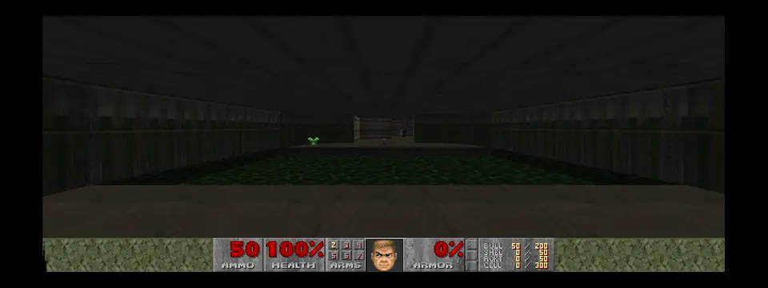

<!-- SPDX-License-Identifier: GPL-2.0-or-later -->
<p align="center">
  <picture>
    <source media="(prefers-color-scheme: dark)" srcset="docs/assets/logo-dark.svg">
    
  </picture>
</p>

<h1 align="center">Doom for NBT Manager</h1>

> **Warning: installing or modifying this software can brick your head unit. Recovery may require professional service or replacement, at your expense. Provided AS IS; use at your own risk, subject to applicable law.** [Read the risk and liability disclaimer](DISCLAIMER.md).

<p align="center">
  <b>The shareware episode on the iDrive screen,</b><br>
  played with the iDrive controller or a USB gamepad.
</p>

<p align="center">
  
</p>

PrBoom+ on the BMW NBT Evo (iDrive 6) head unit: hardware-accelerated OpenGL ES 2
rendering on the car's panel, sound and OPL2 music through the car's speakers, and
the iDrive controller or a wired gamepad as input. Installed and launched through
NBT Manager; built on the NBT App SDK.

**Supported head units:** BMW NBT Evo (iDrive 6). Support for the earlier NBT
may come later.

Part of [NBTFoundry](https://github.com/NBTFoundry):
[manager](https://github.com/NBTFoundry/manager) ·
[sdk](https://github.com/NBTFoundry/sdk) ·
[mobile-app](https://github.com/NBTFoundry/mobile-app) ·
[installer](https://github.com/NBTFoundry/installer) ·
[toolchains](https://github.com/NBTFoundry/toolchains)

Not affiliated with or endorsed by BMW AG or id Software. BMW, iDrive and NBT are
trademarks of BMW AG; DOOM is a trademark of id Software.

## Controls

### iDrive controller

| Control | In a level | In a menu |
| --- | --- | --- |
| Turn the knob | Strafe left / right (the Turn Sensitivity setting sets how long) | Previous / next item |
| Push the knob | Fire | Select (answers *yes* in a yes/no prompt) |
| Tilt (8-way) | Move forward / back, turn left / right | Navigate |
| BACK, tap | Use / open | Back (answers *no* in a yes/no prompt) |
| BACK, double tap (within 350 ms) | Next weapon | — |
| BACK, hold (600 ms) or MENU | Doom's menu | Doom's menu |
| BACK, long hold (1.4 s) | Quit to NBT Manager | Quit to NBT Manager |
| OPTION | Automap | — |
| Favourite keys 1–7 | Weapons 1–7 | — |

The long hold quits cleanly before NBT Manager's own BACK escape (2 s). While Doom
is on screen, NBT Manager keeps MENU, OPTION and the favourite keys from iDrive.

### Wired gamepad

| Gamepad | In a level |
| --- | --- |
| Left stick / D-pad | Move and strafe |
| Right stick, horizontal | Turn (proportional) |
| RT / R2, or X / Square | Fire |
| A / Cross | Use / open |
| LT / L2, or left-stick click | Run while held (unless Always Run is on) |
| LB / L1, RB / R1 | Previous / next weapon |
| Y / Triangle, or View / Share / Create | Automap |
| B / Circle, or Menu / Options | Doom's menu |

In menus the D-pad or left stick navigates (repeating after 400 ms, then every
100 ms), A / Cross selects and B / Circle goes back. The stick dead zone is 20%;
triggers press at 25% and release at 20%. Keys held by different sources are
combined, so unplugging a pad never releases a key the iDrive controller still
holds. A disconnect, lost focus, a malformed state or 500 ms without one clears
the gamepad's keys, and controls held while a pad connects count only once it
was seen neutral. A notice names the pad when it is plugged in (Xbox
controller, DualShock 4, DualSense) and says when it is removed. Which pads are
supported is up to NBT Manager (`NBTFoundry/manager: docs/gamepad-bridge.md`).

The bindings are tables in the NBT App SDK front end's profile format
(`src/doom_controls.cpp`): one per pad family, laid out by button position,
and one for the iDrive controller.

### Desktop keyboard (host build)

Up/Down or W/S to move, A/D to strafe, Left/Right or Q/E to turn, Ctrl or F to
fire, Enter to fire or select, Space to use, Tab for the next weapon, Escape and
Backspace for the menus.

## Settings

Changed from the phone app or NBT Manager's settings page; most apply at once
(capability `live-settings`).

| Setting | Choices | Default |
| --- | --- | --- |
| Turn Sensitivity | low, medium, high | medium |
| Invert Turn | off, on | off |
| Brightness | 0–4 | 2 |
| Always Run | off, on | on |
| Sound | off, on | on |
| Show FPS | off, on (frames per second, top right) | off |
| Debug log | off, on | off |

Volume follows the car's own volume; Doom's **Options → Sound Volume** (effects
and music) scales its output below that and is saved in `prboom-plus.cfg` in
Doom's data folder.

## Bridge

The package carries the guest (built with the NBT toolchain, run by NBT
Manager's `nbt-runner`) and declares bridge 1.7: `show`, `controller` and
`runner` required, `status`, `live-settings` and `gamepad` optional (the
pad's family). It also carries what the phone app shows before an install
(the PrBoom+ version, the project, the licence, notices), so it needs NBT
Manager 0.3.1 or later. Doom reports
`E1M1 H:100%`, `Menu` or `DOOM Shareware` as its status. NBT Manager keeps its
standard output and error as Doom's log (`state/doom/output.log`, shown, shared and
cleared from the phone app). A crash adds a line
`[doom] FATAL sig=… code=… addr=… stage=…`; the Debug log setting adds tracing.

A file `audio-conn` in Doom's data folder holding one connection number (as
`audioconn -l` lists them, for example `0x9a`) makes Doom route its sound through
that connection instead of `0xb8`; the log says so. Delete it to go back.

## Build

Needs the NBT App SDK checked out next to this repository (`../sdk`, or
`NBT_SDK_DIR`), gcc, Python 3, Git LFS, and the X11, EGL and GLESv2 development
files. `git submodule update --init` fetches PrBoom+, `git lfs pull` the
shareware WAD.

```sh
make -j"$(nproc)" host test test-asan check-static-init   # host binary and tests
./build/nbt-doom-host                                     # play on the desktop (X11)
```

Head unit: Doom is GPL, so the application is a **guest**
(`sdk/docs/native-apps.md`): built with the NBT toolchain (`make -C ../sdk
toolchain` once) and run as its own process by the `nbt-runner` NBT Manager
ships (bridge 1.7, `runner`):

```sh
make -j"$(nproc)" guest                                        # build/nbt-doom.guest
make APP_KEY=/path/to/apps-signing-key.pem package             # build/doom-<version>.nbt
make vm-test                                                   # the SDK's VM under QEMU
```

`package` (also `doom-package`) signs the guest with NBT Manager's packer
(`../manager/tools/package.py`, or `NBT_MGR_DIR`), described by
`release/package.args`; `make package-args` writes the PrBoom+ version the pin
builds, and `make test` fails when it lags. `vm-test` runs the guest in the
SDK's VM, with the SDK's own `nbt-runner` (`sdk/docs/native-apps.md`, "Testing
without a head unit", says what building it takes). `make notice` writes
`legal/NOTICE.txt`.

## Releases

`.github/workflows/ci.yml` runs the host tests, the same under ASan/UBSan and
the guest build on every push and pull request. A `vX.Y.Z` tag runs
`.github/workflows/release.yml`: NBT Manager's application release workflow
builds the guest on a plain runner with the NBT toolchain (no private image),
signs it with the apps key after a maintainer approves the run (the `release`
environment, secret `APPS_SIGNING_KEY`, tags `v*` only) and publishes
`doom-X.Y.Z.nbt`, sequence `X*1000000 + Y*1000 + Z`. `release/sdk.ref` is the
SDK commit both build against: [SDK
0.1.0](https://github.com/NBTFoundry/sdk/releases/tag/v0.1.0).

### The shareware WAD

`assets/doom1.wad` (DOOM Shareware v1.9, in Git LFS) is embedded in the binary;
the build stops if the file is an LFS pointer rather than a WAD, and CI and the
release workflow fetch LFS files. Another copy can be given with
`DOOM1_WAD=/path/to/doom1.wad`. Without one, the build looks for `doom1.wad` at
run time in `NBT_DATA_DIR`, `.`, `assets/` and `/app/data`. Its status:
[legal/doom-shareware.md](legal/doom-shareware.md).

### README captures

`tools/capture_demo.sh` records the attract loop's first demo from the host
build under Xvfb and writes `docs/assets/doom-demo.{webp,png}` (needs Xvfb, ffmpeg
with libwebp and ImageMagick).

## Layout

| Path | Contents |
| --- | --- |
| `third_party/prboom-plus/` | PrBoom+ 2.6.66, unmodified (submodule) |
| `src/prboom_compat/` | SDL2/OpenGL compatibility headers, BMP loader, `w_wad.c` wrapper |
| `src/wad_vfs.*`, `src/wad_embed*` | WADs embedded in `.rodata` and the `/embedded/*` file system |
| `src/i_*_nbt.cpp`, `src/main.cpp` | PrBoom+'s platform layer on the SDK |
| `src/doom_settings.*` | Doom's settings and their mapping from the manager's values |
| `src/doom_video.*` | Logical resolution, gamma, the GLES2 batch, the overlay (notices, FPS), host keyboard |
| `src/doom_input.hpp`, `src/doom_controls.*`, `src/input_idrive.*`, `src/input_gamepad.*` | Key codes, the bindings per pad family and for the controller, and their decoders |
| `src/doom_log.*` | Log start-up |
| `tests/` | Unit tests (`doom_test.cpp`) and integration tests (`test_doom.py`) |
| `tools/` | PrBoom+ version for the package (`package_version.py`), notices (`make_notice.py`), README capture |
| `release/` | The package description and the SDK commit to build against |
| `legal/` | Third-party notices (`NOTICE.txt`, generated) and the shareware data's status |

## License

Copyright (c) 2026 Fabien Poussin. Original code, tests, build scripts and documentation are licensed under **GPL-2.0-or-later**; see [LICENSE](LICENSE).

Original NBTFoundry logos, artwork and screenshots are under **MPL-2.0**, including copies in other NBTFoundry repositories. Third-party code, fonts, game data and their notices retain their own terms. Copyright permission for artwork does not grant trademark rights or imply endorsement by BMW AG or id Software.

PrBoom+ and its bundled components retain their upstream licenses and copyright notices. `assets/doom1.wad` is proprietary id Software shareware game data, not GPL-covered code; see `legal/doom-shareware.md` before distributing it.

See [legal/README.md](legal/README.md) for third-party license notices.
